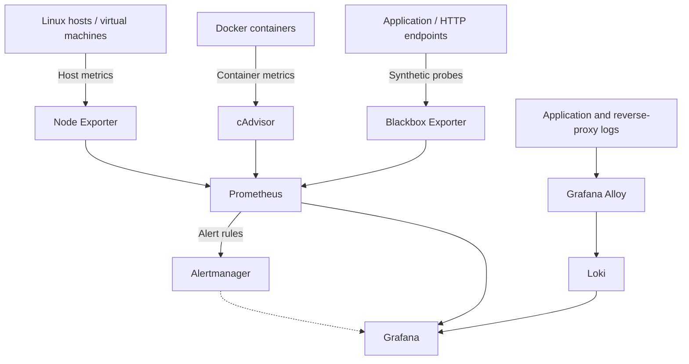

# Production Observability & Incident Monitoring Platform

**A real-world DevOps/SRE case study: unified visibility across applications, Linux hosts, Docker containers, availability probes, logs, and active alerts.**

**Role:** DevOps / Site Reliability Engineering — monitoring architecture, deployment, configuration, troubleshooting, and operational dashboards  
**Project type:** Production-inspired case study of an existing monitoring implementation (not a downloadable copy of its private configuration)  
**Technologies:** Prometheus · Grafana · Alertmanager · Loki · Grafana Alloy · Blackbox Exporter · Node Exporter · cAdvisor · Docker · Linux · Nginx

> **Public portfolio and confidentiality:** Service names, customer identifiers, URLs, hostnames, IP addresses, request identifiers, alert labels and log contents are intentionally anonymized. Screenshots and exported dashboards should be sanitized before publication. Operational views discussed here are snapshots, not claims of guaranteed uptime, response times or ongoing incident-free service.

## Executive summary

I implemented and operated a centralized monitoring and observability platform to provide a shared operational view of application health, infrastructure capacity, container activity, HTTP availability, centralized logs and alert state across several services.

Instead of checking each application or server independently, the platform combines infrastructure telemetry, synthetic probes and log events into Grafana dashboards. An incident-correlation view makes it easier to compare availability changes against CPU, memory and relevant logs during troubleshooting.

This case study describes the observable design and operational practices of that system. For a safe-to-run example without production-specific settings, see my separate [DevOps/SRE Observability Lab](https://github.com/007femijethro/devops-sre-observability-lab).

## The operational challenge

Multi-service applications require visibility at several layers. An HTTP failure may originate from a container, application process, reverse proxy, upstream dependency, network connection or host resource constraint. Isolated health checks cannot establish the whole picture.

The design goals were to:

- View critical service status in one place.
- Monitor host CPU, memory, disk, uptime and load.
- Monitor Docker container resource utilization, restart activity, age and network traffic.
- Track HTTP/HTTPS availability, response timing, DNS lookup timing and certificate expiry.
- Correlate metric anomalies with centralized application/reverse-proxy logs.
- Surface active and pending alerts alongside metric and log evidence.
- Provide navigable views for both quick health checks and deeper incident investigation.

## Architecture



**Data paths:** Prometheus scrapes exporters and evaluates metrics/alert rules; Grafana visualizes Prometheus metrics and Loki logs; Alloy collects and forwards logs into Loki; Alertmanager handles alert routing. Synthetic Blackbox probes provide application-level signals independent of application-reported health.

This is a logical architecture, not a disclosure of network addresses, access controls, host topology or private deployment configuration.

## Monitoring capabilities

| Area | Instrumentation | Operational use |
| --- | --- | --- |
| Service health | Blackbox probes, Grafana status panels | Spot failing or recovering application endpoints |
| Host infrastructure | Node Exporter / Prometheus | Examine CPU, memory, filesystem, load and uptime |
| Container health | cAdvisor / Prometheus | Review resource consumption, container lifecycle and network activity |
| Application performance | HTTP probes | Review HTTP status, end-to-end latency and timing components |
| Certificate monitoring | TLS probe metrics | Identify certificates approaching expiry |
| Logs | Alloy → Loki → Grafana | Investigate service and reverse-proxy activity using timestamps and labels |
| Alerting | Prometheus alert rules / Alertmanager | Review firing and pending alerts; support incident triage |
| Incident correlation | Combined Grafana panels | Compare availability against host utilization and incident-relevant logs |

## Dashboard design

The observed Grafana implementation groups information into operational sections:

1. **Executive Service Health:** status of selected frontends, backends, an application and the public HTTPS endpoint, plus alert counts.
2. **Host / VM Health:** host CPU, memory, disk usage, uptime, load average and scrape-target health.
3. **Application Availability & Performance:** HTTP status codes, TLS certificate time remaining, HTTP response duration, probe history, DNS and processing/transfer times.
4. **Docker Container Health & Capacity:** container inventory, restart count, ages, CPU, memory working set and network throughput.
5. **Centralized Logs:** service, frontend/backend and reverse-proxy logs alongside rates of errors and HTTP 5xx responses.
6. **Alert & Target Inventories:** currently firing/pending alerts, synthetic probe inventory and Prometheus target inventory.
7. **Incident Correlation:** availability over time presented next to host CPU, memory and log events.

## Evidence observed (26 October 2026 dashboard snapshots)

The screenshots supplied for this case study show:

- Four prominently displayed application/service status panels reading **UP** at the time of capture.
- A displayed **43 healthy Prometheus targets** (`sum(up)`) at the time of capture; this is a point-in-time count, not a claim that all configured targets were healthy.
- A container inventory panel showing **34 containers seen** and a selected set of three application containers with a displayed zero restart count.
- HTTP 200 status panels, synthetic probe latency charts and TLS-expiry visibility.
- Active and pending alert tables, including **two firing alerts and zero pending alerts** at one captured moment.
- Application and reverse-proxy log entries available in the centralized logs view.
- CPU, memory and service-availability trends displayed together for incident correlation.

**Important interpretation:** The same screenshots include a failed probe, active alerts, elevated resource charts and some **No data** panels. These are useful troubleshooting signals, not evidence that the platform was entirely healthy. A target's `up=1` means Prometheus scraped the exporter; synthetic endpoint success should be checked separately via `probe_success`.

## Incident investigation workflow

An operator can use the platform to investigate an availability alert as follows:

1. **Detect:** identify a changed service-state panel or a firing alert.
2. **Scope:** confirm the affected endpoint using `probe_success`, probe status/latency and the alert labels.
3. **Correlate:** compare the failure timeline with host CPU/memory/disk and container metrics.
4. **Inspect logs:** filter Loki by relevant service/container and time range; look for reverse-proxy failures or application errors.
5. **Respond:** apply the appropriate approved recovery or escalation procedure.
6. **Verify:** re-check endpoint probe success, target health, log errors and alert state.
7. **Document:** record the incident timeline, root-cause evidence, actions taken and follow-up improvements.

This is a documented investigation workflow; the screenshots alone do **not** establish a specific resolved incident, mean time to detect/recover, an SLO, or a completed postmortem.

## Engineering decisions and trade-offs

- **Metrics plus logs:** Numeric telemetry highlights a problem; relevant logs supply diagnostic context.
- **Synthetic checks:** Endpoint probes help catch availability failures not visible from container state alone.
- **Layered dashboards:** Executive overview panels enable quick triage; lower-level charts support root-cause investigation.
- **Alert state visibility:** Putting firing alerts near health metrics accelerates prioritization, but alert rules need tuning to avoid noise.
- **Clear limitations:** A `No data` panel calls for investigation into scrape targets, collector labels, query logic or application instrumentation. It should not automatically be interpreted as a healthy service.
- **Confidentiality:** Internal topology, customer systems and raw production logs are intentionally excluded from the public repository.

## Validation and follow-up

For the separate public demonstration lab, I validated Docker Compose and Prometheus rules, started the eight-container stack, and observed successful scrape (`up=1`) results for Prometheus, Node Exporter, cAdvisor and the Blackbox Exporter. The lab's two alert rules passed validation. This is **separate evidence** from the production-observability screenshots described here.

Suggested follow-up evidence for this case study:

- Publish **sanitized** captures of the main dashboard sections, with all addresses, customer names, log payloads, unique IDs and potentially sensitive alert details removed.
- Explain one **authorized** real incident using a redacted timeline; do not include proprietary details.
- Demonstrate alert notification delivery and, if available, incident-runbook and recovery evidence.
- Record validated SLOs, error budgets, DORA metrics, MTTD/MTTR **only if measured and documented**.
- Add a limitations section for Docker Desktop metrics versus Linux host metrics where applicable to the demo lab.

## Repository contents

```text
production-observability-case-study/
├── README.md                 # This case study
├── architecture/             # Sanitized logical diagrams (optional)
├── screenshots/              # Redacted dashboard evidence (after review)
└── incident-examples/        # Approved anonymized write-ups (optional)
```

## What this project demonstrates to employers

This work highlights practical experience with observability architecture, multi-service operational visibility, container and host monitoring, synthetic availability checks, centralized log ingestion, actionable dashboard construction and incident investigation across layers of a distributed environment.

**Relevant positions:** Site Reliability Engineer · DevOps Engineer · Platform Engineer · Release Engineer · Production/Observability Engineer

---

**Author:** [Femi-Muyiwa Jethro Olufemi](https://github.com/007femijethro)  
**Related reproducible project:** [DevOps/SRE Observability Lab](https://github.com/007femijethro/devops-sre-observability-lab)
